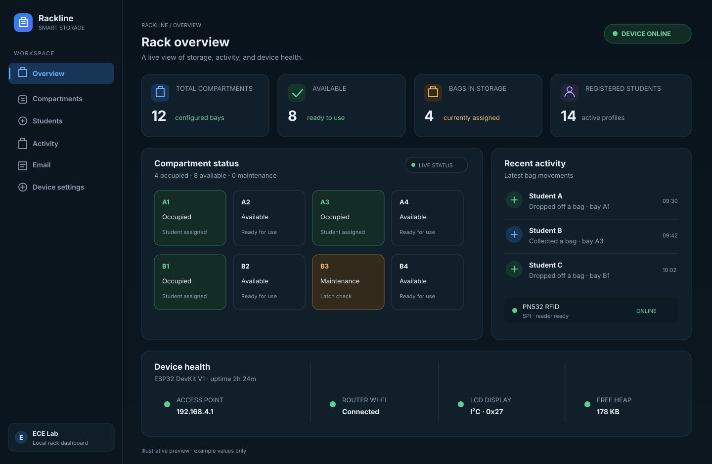
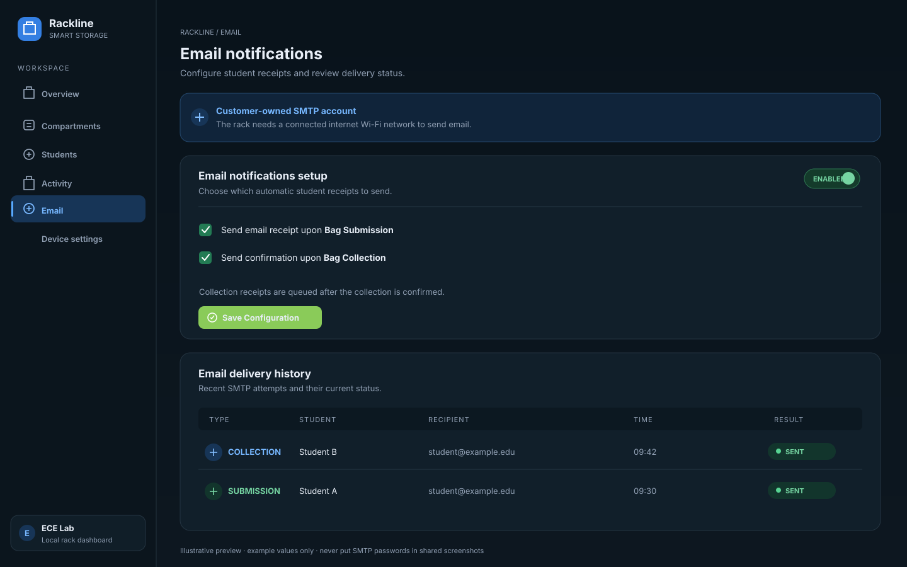
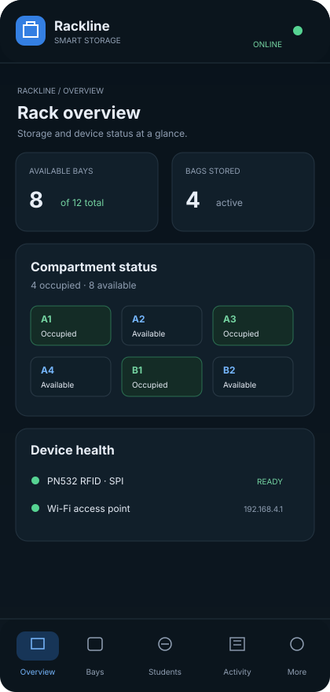

# ECE Lab Smart Rack System

An ESP32 DevKit V1 project for assigning RFID cards to storage compartments, confirming bag collection, and managing the rack from a local web dashboard. The current build uses a **PN532 over SPI**, an optional I²C LCD, LittleFS for local records, and a Wi-Fi access point for the dashboard.

> The dashboard pictures below are layout previews with sample names and values. They are not screenshots of live rack data.

## Dashboard previews

### Desktop overview



### Email setup and delivery history



### Mobile layout



## What it does

- Enrolls students and associates each student record with an RFID card UID.
- Assigns the first available compartment when an enrolled student taps a card without a bag currently stored.
- Starts a collection when a student taps a card that has an assigned compartment. Collection must be confirmed from the dashboard or the physical confirmation button.
- Sends configurable submission and collection email receipts to the email address stored in that student's profile.
- Shows rack status, compartments, students, activity history, email configuration, and device health in the dashboard.
- Saves student records, rack settings, assignment history, and email logs in LittleFS.
- Uses WebSocket updates for dashboard events, with periodic status refresh as a fallback.

### RFID read scope

This project reads **ISO/IEC 14443-A card UIDs** for lookup and assignment. It does not read arbitrary card memory, protected sectors, passwords, or every RFID technology. A UID identifies a card; it is not the personal information stored in a student database.

## Hardware

- ESP32 DevKit V1 (classic ESP32)
- PN532 NFC/RFID module, with its interface switches/jumpers set to **SPI**
- Optional 16×2 I²C LCD, normally at address `0x27`
- Optional collection-confirmation pushbutton
- Optional success and error LEDs with current-limiting resistors
- USB cable and a 2.4 GHz Wi-Fi router with internet access for email

## Wiring

| PN532 / device | ESP32 DevKit V1 | Notes |
| --- | --- | --- |
| PN532 SCK | GPIO18 | SPI clock |
| PN532 MISO | GPIO19 | SPI data to ESP32 |
| PN532 MOSI | GPIO23 | SPI data from ESP32 |
| PN532 SS / SSEL / NSS | GPIO27 | SPI chip select |
| PN532 GND | GND | Share ground with the ESP32 |
| PN532 VCC | Module-supported supply | Check your board; ESP32 signal pins are 3.3 V only |
| LCD SDA | GPIO21 | I²C data |
| LCD SCL | GPIO22 | I²C clock |
| LCD GND | GND | Common ground |
| LCD VCC | LCD-supported supply | Ensure SDA/SCL are not pulled up to 5 V |
| Collection button | GPIO32 to 3.3 V when pressed | GPIO32 uses the ESP32 internal pulldown |
| Success LED | GPIO25 through a resistor | Optional |
| Error LED | GPIO33 through a resistor | Optional |

For SPI mode, **PN532 IRQ and reset are not connected or used** by this sketch. Do not connect the PN532's I²C/SDA/SCL pins as the reader bus; those pins are only used for the separate LCD. Connect all grounds together. If the LCD backpack pulls I²C lines up to 5 V, use a level shifter or a 3.3 V-compatible backpack.

Pin definitions and the default access-point credentials are in [`Config.h`](Config.h).

## Project files

```text
smart_rack_system/
├── smart_rack_system.ino       Main setup, web APIs, and main loop
├── RFIDManager.ino/.h          PN532 SPI polling and card UID handling
├── AssignmentManager.ino/.h    Bag assignment and collection confirmation
├── StudentManager.ino/.h       Student and UID records
├── CompartmentManager.ino/.h   Compartment state and allocation
├── EmailManager.ino/.h         SMTP configuration, queue, and delivery logs
├── LCDManager.ino/.h           Optional I²C LCD screens
├── StorageManager.ino/.h       LittleFS settings and record storage
├── Config.h                    Pins, limits, and access-point defaults
├── Models.h                    Shared application data structures
├── data/                       Web dashboard files uploaded to LittleFS
└── docs/images/                README dashboard previews
```

Keep the `.ino` and `.h` files together in the `smart_rack_system` sketch folder. Open `smart_rack_system.ino` in Arduino IDE.

## Arduino IDE setup

1. Install **Arduino IDE 2.x**.
2. In Boards Manager, install **esp32 by Espressif Systems**. This sketch is intended for the ESP32 Arduino core 3.x.
3. In Library Manager, install:
   - ArduinoJson **6.x**
   - ESPAsyncWebServer by **ESP32Async**
   - AsyncTCP by **ESP32Async**
   - Adafruit PN532
   - Adafruit BusIO (PN532 dependency)
   - LiquidCrystal_I2C
4. Connect the ESP32 and open `smart_rack_system.ino`.
5. Select **Tools → Board → ESP32 Arduino → ESP32 Dev Module** and select the COM port shown for the board.
6. Use these board settings:

   - Partition Scheme: **No OTA (2MB APP/2MB SPIFFS)**
   - Flash Size: **4MB**
   - Upload Speed: start with **115200** if higher speeds fail
   - Serial Monitor: **115200 baud**

## Upload the firmware and dashboard

The sketch and the dashboard are uploaded separately.

### 1. Upload the firmware

In Arduino IDE, click **Upload** (right-arrow). Wait for the compile and flash operation to finish. If the ESP32 does not connect, hold its **BOOT** button while the IDE shows “Connecting…”, then release it after writing begins.

### 2. Upload the dashboard to LittleFS

The `data/` folder must sit beside `smart_rack_system.ino`.

1. Install the Arduino IDE LittleFS uploader from the [arduino-littlefs-upload project](https://github.com/earlephilhower/arduino-littlefs-upload).
2. Select the same ESP32 board, COM port, and **No OTA (2MB APP/2MB SPIFFS)** partition scheme.
3. Close Serial Monitor so the uploader can access the COM port.
4. Use **Ctrl+Shift+P** and choose **Upload LittleFS to Pico/ESP8266/ESP32** (the command may be named slightly differently by the installed extension).
5. Wait for the upload to complete, then reset the ESP32 and open Serial Monitor at 115200 baud.

Uploading a new LittleFS image can replace files stored there, including student records and saved settings. Back up any needed records before uploading the filesystem again. To update only the dashboard, the `data/` folder is the filesystem image source; to update firmware behavior, use the normal Arduino **Upload** button too.

## Start and open the dashboard

1. Reset the ESP32 and check Serial Monitor. Startup should include messages similar to:

   ```text
   [RFID] PN532 ready over SPI, firmware ...
   [WIFI] AP Started. IP Address: 192.168.4.1
   [WEB] LittleFS /index.html: found
   [WEB] Starting HTTP server...
   ```

2. On a laptop or phone, connect to the ESP32 Wi-Fi access point:

   - SSID: `ECE-SMART-RACK`
   - Default password: `1122334455`

3. Open **http://192.168.4.1** in a browser. Keep the device connected to the ESP32 Wi-Fi while using the local dashboard.

The default AP password is included for first setup. Change it in `Config.h` before using the rack in a shared environment, then upload the firmware again. The ESP32 can also connect to a 2.4 GHz router from the dashboard's **Device Settings** page. The setup AP remains available; router internet is needed for outbound email.

## Normal bag workflow

### Enroll a student

Use the dashboard's student enrollment flow to scan a card and enter the student's details. Add the student's correct email address if they should receive receipts. Each card UID must be unique in the student list.

### Store a bag

The student taps their enrolled card. If they do not currently have a bag assigned, the rack allocates an available compartment, records the event, and queues a submission email when notifications are enabled.

### Collect a bag

1. The student taps the same enrolled card. The rack identifies the assigned compartment and starts a pending collection.
2. Confirm the collection using the dashboard confirmation control or the physical button connected to GPIO32.
3. Confirmation releases the compartment and records the collection time. If enabled, a collection receipt is queued for the student's saved email address.

Pending collection confirmation expires after about **20 seconds**. Confirm during that interval. Email delivery is asynchronous, so the confirmation page can respond before the SMTP transaction completes; check the Email page's delivery log for the final result.

## Email setup

1. Connect the rack to a router with internet access in **Device Settings**. The ESP32 uses 2.4 GHz Wi-Fi.
2. Open the dashboard's **Email** page and enable **Email Notifications**.
3. Enable **Bag Submission** and **Bag Collection** receipts as desired.
4. For Gmail, use `smtp.gmail.com`, port `465`, SSL/TLS, the Gmail account as the username, and a Google **App Password**. A normal Gmail account password will usually be rejected. Keep the app password private; do not put it in this README or share it in screenshots.
5. Save the settings. Use **Send Test** and then check the delivery log for the result.
6. Confirm each student's email address is present in the Students page.

Submission and collection notifications have separate checkboxes. If a bag submission email arrives but a collection email does not, check **Bag Collection** is enabled, confirm the student has a valid saved email address, and inspect the Serial Monitor and Email delivery log after collection.

## Dual-core task layout

- **Core 0 — RFID scan task:** polls the PN532 and sends compact UID events through a FreeRTOS queue. It does not mutate rack records.
- **Core 1 — Arduino loop:** processes card events, scans the confirmation button, updates the LCD, and handles rack state changes.
- **Core 1 — email worker:** handles queued SMTP/TLS sends independently so network waits do not hold the application state lock or pause the main loop.
- **Shared state:** a FreeRTOS recursive mutex protects application data while API handlers and the main loop access it.

## Troubleshooting

| Symptom | Check |
| --- | --- |
| PN532 is not found | Set the module switches to SPI; check GPIO18/19/23/27, power, and common ground. The Serial Monitor should report PN532 firmware when detected. |
| PN532 is found but cards are missed | Present an ISO14443-A card/UID to the antenna face, hold it close, and verify the card is registered for rack assignments. This build polls ISO14443-A. |
| Dashboard is blank or missing | Check for `[WEB] LittleFS /index.html: found`. Upload the `data/` directory using the LittleFS uploader, then reload the browser. |
| Browser cannot reach the ESP32 | Connect to `ECE-SMART-RACK`, open `http://192.168.4.1`, and confirm Serial Monitor reports the AP IP and HTTP server startup. |
| Wi-Fi connects but emails do not send | Verify the router connection and internet access, SMTP host/port, sender and username, Gmail App Password, and Email delivery log error. The ESP32 AP alone has no internet uplink. |
| No email after collection | Enable both the main email switch and the Bag Collection receipt checkbox; make sure the student's email is valid; confirm before the 20-second timeout. Serial output reports whether the receipt was queued or why it was skipped. |
| Upload fails to connect | Close Serial Monitor, select the correct COM port, lower Upload Speed to 115200, and hold BOOT while “Connecting…” is displayed if needed. |

## Notes

- The dashboard and its API are served locally by the ESP32. The dashboard is not a public internet website.
- SMTP credentials are stored in the device's local LittleFS configuration. Do not share a filesystem image or Serial/API capture if it contains private configuration or student information.
- The built dashboard files are in `data/`; edit those files if updating the static web content.
